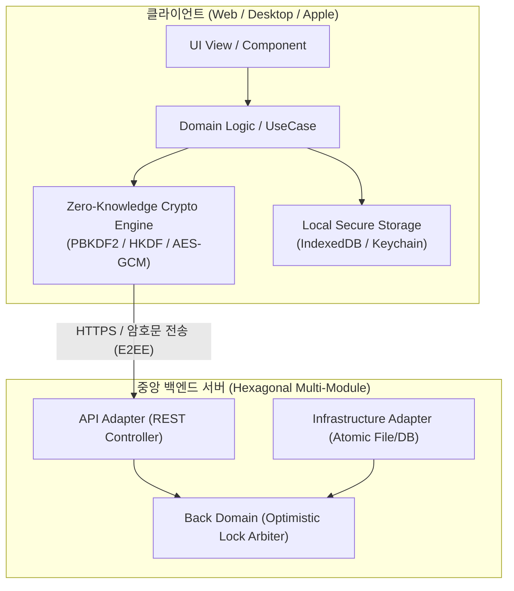

# KeyManage

> **KeyManage**는 영지식(Zero-Knowledge) 보안 원칙에 기반하여 마스터 키 유도와 볼트 암·복호화를 오직 클라이언트 내부에서만 수행하고 서버에는 암호문(Ciphertext)만을 저장하는 멀티 플랫폼(Web, Desktop, iOS, macOS) 종단간 암호화(E2EE) 패스워드 매니저입니다.

---

## 목차
- [주요 기능](#주요-기능)
- [아키텍처 및 폴더 구조](#아키텍처-및-폴더-구조)
- [기술 스택](#기술-스택)
- [사용법](#사용법)
- [트러블 슈팅](#트러블-슈팅)

---

## 주요 기능

### 1. 영지식(Zero-Knowledge) 종단간 암·복호화
평문 마스터 비밀번호 및 복호화 키의 외부 송출을 차단하며, 일체의 암·복호화 연산은 클라이언트 내부 격리 환경에서만 수행합니다.
<details>
<summary><strong>상세 스펙 및 기술 규격 (SEC-001, vault-spec)</strong></summary>

- **클라이언트 전용 암·복호화**: 서버는 오직 암호문(Ciphertext) 저장소 역할만 수행하며, 복호화 키에 대한 접근 권한이 원천 배제됩니다.
- **표준 암호화 알고리즘 규격**:
  - 키 유도: `PBKDF2-HMAC-SHA256` (반복 횟수 600,000회 이상, 16바이트 솔트)
  - 도메인 키 분리: `HKDF-SHA256`을 통해 서버 인증 해시(`authKey`)와 볼트 암호화 키(`encryptionKey`)를 엄격히 분리
  - 볼트 암호화: `AES-256-GCM` (12바이트 무작위 IV, 16바이트 무결성 인증 태그, AAD 무결성 검증)
- **교차 플랫폼 암호 벡터 검증**: WebCrypto, CryptoKit(Apple), JDK 상호 간 동일한 테스트 벡터(`crypto-test-vectors.json`) 교차 검증 통과
</details>

### 2. 낙관적 잠금 기반 볼트 동기화 및 다중 기기 충돌 병합
단조 증가 리비전 정수를 기반으로 동시 수정 충돌을 감지하고, 항목별 최종 수정 시각 기준 3-way 자동 병합을 수행합니다.
<details>
<summary><strong>상세 스펙 및 병합 정책 (VLT-001)</strong></summary>

- **리비전 기반 버전 통제**: 클록 오차에 따른 시간 왜곡을 방지하기 위해 단조 증가하는 정수형 `revision`으로 버전을 관리합니다.
- **3-way 항목 단위 자동 병합**: 동시 수정으로 인한 `409 Conflict` 감지 시 서버 최신 볼트를 조회하여 항목별 `updatedAt` 타임스탬프 기준으로 자동 병합한 뒤 재시도합니다.
- **상위 스키마 읽기 전용 보호**: 클라이언트 버전보다 높은 스키마 버전의 볼트 인입 시 데이터 손실 방지를 위해 즉시 읽기 전용(`readOnly`)으로 전환합니다.
- **안전 삭제(Tombstone) 및 폐기**: 삭제된 항목은 `deletedAt` 기록을 남겨 타 기기 동기화 시 되살아나는 문제를 방지하고, 민감 정보(비밀번호, 메모)는 즉시 영구 소거 처리합니다.
</details>

### 3. 난수 발생기(CSPRNG) 기반 비밀번호 생성 및 엔트로피 점수 진단
평문 유출 없이 클라이언트 암호학적 난수 생성기로 규격을 충족하는 비밀번호를 생성하고 Shannon 엔트로피 점수를 실시간 진단합니다.
<details>
<summary><strong>상세 스펙 및 생성 규칙 (GEN-001)</strong></summary>

- **클라이언트 로컬 CSPRNG 구동**: 평문 비밀번호의 네트워크 노출을 차단하기 위해 클라이언트 내장 암호학적 난수 생성기(`Crypto.getRandomValues` / `SecRandomCopyBytes`)만 사용합니다.
- **문자군 조합 규격 충족**: 8~64자 길이 제어, 4대 문자군(영문 대소문자·숫자·특수기호 26종) 필수 포함 및 거부 샘플링을 통한 편향 결함 방지
- **엔트로피 점수 계측**: Shannon 엔트로피 수식을 기반으로 0~100점 환산 및 4단계 강도 게이지 표출
- **취약 패턴 경고**: 연속/역순 숫자(`123`, `987` 등) 패턴 식별 시 주의 안내 문구를 표기합니다.
</details>

### 4. 보안 클립보드 버퍼 및 30초 자동 소각(Zero-filling)
비밀번호 복사 후 30초 타이머 경과 또는 앱 잠금·백그라운드 전환 감지 시 클립보드 메모리를 강제 소거합니다.
<details>
<summary><strong>상세 스펙 및 소각 정책 (COM-001)</strong></summary>

- **자동 소각 타이머**: 비밀번호 복사 시점부터 30초 카운트다운을 개시하며, 만료 즉시 시스템 클립보드를 공백화합니다.
- **이벤트 기반 즉각 차단**: 앱 잠금, 절전 모드, 백그라운드 전환 등 보안 경계 변경 감지 시 타이머 잔여 시간과 무관하게 클립보드를 즉시 비웁니다.
</details>

### 5. 오프라인 대기 큐 및 기기 볼트 암호화 보존
네트워크 연결 장애 시에도 변경 사항을 로컬 큐에 안전하게 대기시키며, 기기 전원 차단 후에도 암호화 상태로 유지합니다.
<details>
<summary><strong>상세 스펙 및 저장 정책 (VLT-002, VLT-003)</strong></summary>

- **오프라인 대기 큐 (Pending Sync Queue)**: 네트워크 단절 시 변경 내역을 로컬에 보존하고 `pendingSync` 큐에 유지하며, 재연결 감지 즉시 서버 동기화 시퀀스를 개시합니다 (VLT-002).
- **암호화 기기 저장소**: 앱 재기동 후에도 데이터 영속성을 보장하도록 클라이언트 로컬 저장소(IndexedDB / Keychain)에 암호문 상태로 안전하게 보존합니다 (VLT-003).
</details>

### 6. 자동 유휴 잠금 및 생체 인증(Biometrics) 접근 제어
지정 유휴 시간 초과 시 휘발성 메모리를 즉시 제로화(Zeroing) 소거하여 잠금 조치하고, 생체 센서 인증을 통해 정상 상태로 복귀합니다.
<details>
<summary><strong>상세 스펙 및 보안 지침 (SEC-003)</strong></summary>

- **5단계 유휴 타임아웃**: 즉시(0초), 1분, 5분, 15분, 1시간 유휴 상태 지속 시 자동으로 볼트를 잠급니다.
- **휘발성 메모리 물리 소거**: 잠금 즉시 복호화 키 및 평문 볼트 잔류 메모리를 0으로 완전히 덮어씁니다 (`memset_s` / 메모리 제로화 기법).
- **생체 인증(Touch ID / Face ID / Windows Hello) 연동**: 간이 해제를 지원하되, 14일 주기 마스터 비밀번호 재인증 강제 및 기기 생체 데이터 변경 시 기존 등록 세션을 즉시 무효화합니다.
</details>

### 7. AES-256-GCM 독립 암호화 백업 컨테이너 및 무결성 복구
마스터 비밀번호와 완전 분리된 독립 백업 비밀번호를 기반으로 위·변조가 차단된 암호화 백업 파일(`.keymanage-backup`)을 생성하고 복원합니다.
<details>
<summary><strong>상세 스펙 및 복구 절차 (VLT-004, ADR-0022)</strong></summary>

- **독립 백업 키 분리**: 통상 마스터 키 유도 체계와 분리된 백업 전용 패스워드를 인가하여 `AES-256-GCM` 컨테이너로 패키징합니다.
- **무결성 검증 및 롤백**: 컨테이너 복원 전 파일 변조 여부를 선행 검증하며, 이상 없을 시 백업 시점의 스냅샷으로 완전 롤백 복원합니다.
</details>

---

## 아키텍처 및 폴더 구조

KeyManage는 백엔드와 프론트엔드 전반에 걸쳐 비즈니스 도메인을 프레임워크와 완전히 격리하는 설계를 유지합니다.

### 핵심 설계 원칙

1. **영지식(Zero-Knowledge) 보안 격리**: 마스터 키 유도 및 암·복호화 연산은 클라이언트 내부에서만 수행하며, 중앙 서버는 암호문 외 어떠한 키 데이터도 보관하지 않습니다.
2. **포트-어댑터(Hexagonal) 멀티 모듈**: 백엔드는 비즈니스 도메인(`domain`)을 중심으로 인바운드/아웃바운드 어댑터(`api`, `infrastructure`, `app`)의 관심사를 엄격히 분리합니다.
3. **의존성 역전(DIP) 및 덤 뷰(Dumb View)**: 프론트엔드 UI 계층은 비즈니스 로직을 배제한 상태 표출 껍데기로 유지하며, 백엔드 통신 및 암호화 모듈은 추상화 인터페이스를 통해 주입받습니다.

### 전체 시스템 흐름도



<details>
<summary><strong>레포지토리 디렉터리 구조 및 플랫폼별 세부 문서</strong></summary>

```text
KeyManage/
├── Apps/
│   ├── Apple/                 # Apple 네이티브 앱 (iOS, macOS) ➔ [Apple README](Apps/Apple/README.md)
│   │   ├── Projects/          # Tuist 4 마이크로 피처 모듈 (Core, Features, App)
│   │   └── docs/              # Apple 플랫폼 전용 ADR 및 명세
│   └── Web/                   # React 19 + Tauri v2 웹/데스크톱 앱 ➔ [Web README](Apps/Web/README.md)
│       ├── src/               # Clean Architecture 계층화 소스코드
│       ├── src-tauri/         # Tauri v2 데스크톱 네이티브 셸
│       └── docs/              # Web 플랫폼 전용 ADR 및 명세
├── Back/                      # Spring Boot 3.4 헥사고날 백엔드 ➔ [Backend README](Back/README.md)
│   ├── domain/                # 순수 Kotlin 비즈니스 도메인 및 유스케이스 코어
│   ├── api/                   # Spring Web MVC REST API 컨트롤러 및 필터
│   ├── infrastructure/        # 원자적 파일 볼트 저장소 어댑터
│   └── app/                   # 조립 루트(Composition Root)
├── Docker/                    # 로컬 데모 실행용 Dockerfile 및 Caddyfile
├── Scripts/                   # 다중 플랫폼 정적 검증 및 품질 통제 스크립트
├── Tools/                     # 교차 플랫폼 암호 테스트 벡터 검증기
├── docs/                      # 프로젝트 통합 문서 (정책 SSOT, 공통 ADR, 명세)
│   ├── policies/              # 서비스 정책 SSOT (SEC, VLT, GEN, COM)
│   ├── adr/                   # 시스템 공통 아키텍처 결정 기록
│   ├── ai-usage/              # AI 협업 및 검증 기록 로그
│   ├── vault-spec.md          # 볼트 암호화 및 병합 표준 명세서
│   └── api-spec.md            # 백엔드 REST API 계약 명세서
└── AGENTS.md                  # 범용 개발 및 협업 가이드라인 (CLAUDE.md 호환)
```
</details>

---

## 기술 스택

각 플랫폼별 상세 아키텍처 및 세부 모듈 사양은 해당 플랫폼의 README 링크에서 확인할 수 있습니다.

| 영역 | 기술 스택 | 설명 | 상세 가이드 |
| :--- | :--- | :--- | :--- |
| **Backend** | Kotlin 2.1, Spring Boot 3.4, Gradle | 4개 모듈 분리 헥사고날 아키텍처, PIT 뮤테이션 테스트 | [Backend README](Back/README.md) |
| **Web Client** | React 19, TypeScript 5.8, Vite 6 | Clean Architecture, Tailwind CSS v4, WebCrypto API, Vitest | [Web README](Apps/Web/README.md) |
| **Desktop Shell**| Tauri v2, Rust | 경량 네이티브 웹뷰 래퍼, 시스템 트레이 제어 | [Desktop README](Apps/Web/README.md#데스크톱-앱-tauri-v2) |
| **Apple Client** | Swift 6, Tuist 4, Uber microRIBs | Strict Concurrency, CryptoKit, Swift Testing, LocalAuthentication | [Apple README](Apps/Apple/README.md) |
| **Infra & Demo** | Docker Compose, Caddy 2, mkcert | 로컬 리버스 프록시, 자동 상호 HTTPS 환경 구성 | [ADR-0021](docs/adr/ADR-0021-local-docker-compose-demo.md) |
| **Verification** | Python 3, Bash, GitHub Actions | 5중 기계적 정적 게이트, 최신성 및 PR Rebase 강제 훅 | [ADR-0009](docs/adr/ADR-0009-verification-delegation-pipeline.md) |

---

## 사용법

> **요약** 로컬 환경에서 Docker Compose로 백엔드와 웹을 간편하게 실행할 수 있습니다. 웹만 사용하는 경우 Docker만 있으면 되며, 데스크톱 앱까지 연동할 경우 `mkcert`를 통해 로컬 HTTPS 환경을 구성합니다 ([ADR-0021](docs/adr/ADR-0021-local-docker-compose-demo.md)).

| 사용 환경 | 접속 인터페이스 | 필수 준비물 |
| :--- | :--- | :--- |
| 웹 브라우저 단독 실행 | http://localhost:8080 | Docker Desktop |
| 웹 + 데스크톱 앱 (Windows) 연동 | https://localhost:8443 | Docker Desktop, mkcert |

<details>
<summary><strong>1. 웹 브라우저로만 사용하기 (포트 8080)</strong></summary>

1. [Docker Desktop](https://www.docker.com/products/docker-desktop/)을 설치하고 실행합니다.
2. 레포지토리 루트에서 컨테이너를 빌드하고 실행합니다:
   ```bash
   docker compose up -d --build
   ```
3. 빌드가 완료되면 웹 브라우저에서 [http://localhost:8080](http://localhost:8080)으로 접속합니다.
</details>

<details>
<summary><strong>2. 데스크톱 앱까지 함께 사용하기 (HTTPS 포트 8443, Windows)</strong></summary>

데스크톱 앱은 보안 정책상 `https://localhost:8443`으로만 서버와 통신합니다. 로컬 신뢰 인증서를 생성한 후 데모를 실행합니다.

1. **mkcert 설치**:
   - Windows: `winget install FiloSottile.mkcert`
   - macOS: `brew install mkcert`
2. **로컬 CA 루트 인증서 등록**:
   ```bash
   mkcert -install
   ```
3. **로컬 인증서 발급 (`certs` 디렉터리)**:
   ```bash
   cd certs
   mkcert -cert-file localhost.pem -key-file localhost-key.pem localhost
   cd ..
   ```
4. **컨테이너 실행 및 확인**:
   ```bash
   docker compose up -d --build
   ```
   (이미 실행 중인 경우: `docker compose restart caddy`)
5. 웹 브라우저에서 [https://localhost:8443](https://localhost:8443) 접속 확인 후 데스크톱 앱을 실행합니다.

> [!NOTE]
> **데스크톱 앱 직접 빌드 시**:
> Node.js 22.18+, Rust, Visual Studio C++ 빌드 도구가 설치된 환경에서 `Apps/Web` 폴더로 이동 후 실행합니다:
> ```powershell
> cd Apps/Web
> npm ci
> $env:VITE_API_BASE_URL = 'https://localhost:8443'
> npm run tauri:build
> ```
> 빌드된 설치 파일(NSIS)은 `Apps/Web/src-tauri/target/release/bundle/nsis/`에 생성됩니다.
</details>

<details>
<summary><strong>3. 신규 계정 가입 차단 설정 (Registration Lockout)</strong></summary>

내 계정을 생성한 후 추가 가입을 막으려면, 레포지토리 루트의 `.env` 파일에 다음 환경변수를 설정하고 다시 실행합니다:
```bash
KEYMANAGE_REGISTRATION_ENABLED=false
```
적용:
```bash
docker compose up -d
```
</details>

<details>
<summary><strong>4. 컨테이너 종료 및 데이터 초기화</strong></summary>

| 작업 내용 | 실행 명령 | 비고 |
| :--- | :--- | :--- |
| 컨테이너 중지 (볼트 데이터 보존) | `docker compose down` | 볼트 암호화 데이터 유지 |
| 컨테이너 중지 및 볼트 데이터 완전 삭제 | `docker compose down -v` | 모든 사용자 및 볼트 데이터 영구 삭제 |
| 로컬 mkcert 루트 인증서 삭제 | `mkcert -uninstall` (이후 `certs` 폴더 내부 pem 파일 삭제) | 로컬 TLS 신뢰 체인 해제 |

> [!CAUTION]
> `docker compose down -v` 명령은 저장된 모든 계정과 볼트 데이터를 완전히 삭제하며 복구할 수 없습니다.
</details>

---

## 트러블 슈팅

각 플랫폼별 주요 트러블 슈팅 및 문제 해결 가이드는 아래 링크에서 확인할 수 있습니다.

- [Web / 데스크톱 클라이언트 트러블 슈팅](Apps/Web/README.md#트러블-슈팅)
- [Apple 클라이언트 트러블 슈팅](Apps/Apple/README.md#트러블-슈팅)
- [Backend 트러블 슈팅](Back/README.md#트러블-슈팅)
