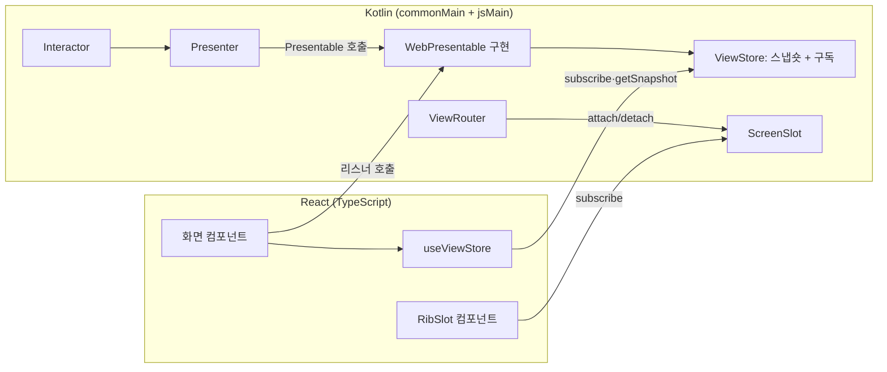

# carti-RIBs-KMP React 브리지 설계

- 상태: 조사 문서(실험 브랜치 `research/kmp-migration` 전용, main에 합치지 않는다)
- 날짜: 2026-11-12
- 관련: [target-architecture.md](target-architecture.md) 5장 3번

> **요약** React 뷰는 Kotlin의 `Presentable` 인터페이스를 직접 구현하지 않는다. Kotlin 쪽 Presentable 구현이 화면 상태를 담은 저장소(`ViewStore`)를 내보내고, React는 지금 웹 앱처럼 `useSyncExternalStore`로 구독한다. 사용자 입력은 내보낸 리스너 함수를 부른다. 라우팅은 Swift 브리지의 `RIBScreenSlot`처럼 "지금 붙은 자식 화면" 슬롯을 React가 그린다.

---

## 1. 지금 상태

| 항목 | carti-RIBs-KMP | KeyManage 웹 앱 |
| :--- | :--- | :--- |
| JS 대상 | `ribs-core`에 `js { nodejs() }`만 있다. 브라우저 대상·React 연동 없음 | — |
| 뷰 연결 방식 | 플랫폼이 RIB마다 `XxxPresentable`을 구현해 `ViewFactory`로 주입(ADR-0006). Swift는 `RIBScreenSlot`으로 자식 화면을 그린다 | React 19. 외부 상태는 `useSyncExternalStore`로 구독(`useAutoLockSetting`, `useNetworkOffline`) |
| 스레드 | 메인 스레드 검사는 플랫폼이 주입(ADR-0007). JS에서는 `Main.immediate`가 없어 `Main`으로 대신 | 단일 스레드 |
| 데스크톱 | — | Tauri가 같은 웹 번들을 띄운다 |

## 2. 선택지

| 방식 | 설명 | 판단 |
| :--- | :--- | :--- |
| A. React가 Presentable 구현 | Swift처럼 TypeScript가 Kotlin 인터페이스를 구현해 `ViewFactory`로 넘긴다 | 채택 안 함. Kotlin/JS `@JsExport`로 내보낸 인터페이스를 TypeScript가 구현하는 기능은 아직 실험 단계다. React 컴포넌트는 함수라 "명령형 메서드를 받는 객체"와 맞지 않는다(`showLoading(true)` 같은 호출을 상태로 바꾸는 코드를 화면마다 TypeScript로 써야 한다) |
| B. Kotlin이 상태 저장소를 내보냄 | Presentable 구현을 Kotlin에 두고, 그 구현이 화면 상태 스냅숏을 담은 `ViewStore`를 내보낸다. React는 구독만 한다 | **채택** |
| C. Compose for Web | 뷰까지 Kotlin으로 그린다 | 범위 밖. 목표는 "뷰는 React로 남긴다"이다 |

B를 고른 이유:

- 웹 앱이 이미 쓰는 패턴(`useSyncExternalStore`)과 같다. React 쪽에 새 개념이 없다.
- 화면 상태 변환이 Kotlin에 있으므로 "뷰 외 전부 Kotlin" 목표에 맞는다. TypeScript는 스냅숏을 그리고 함수를 부르기만 한다.
- Kotlin에서 내보내는 것은 클래스·함수뿐이라 `@JsExport`의 안정된 부분만 쓴다.

## 3. 구조



### 3.1 라이브러리에 추가할 것 (carti-RIBs-KMP)

| 위치 | 추가 | 설명 |
| :--- | :--- | :--- |
| `ribs-core` | `js { browser() }` | 브라우저 테스트(Karma Chrome Headless) 포함. 공통 코드는 바꾸지 않는다 |
| 새 모듈 `ribs-web` (`jsMain`) | `ViewStore<S>` | `getSnapshot(): S`, `subscribe(listener): () -> Unit`, Kotlin 쪽 `update(S)`. 스냅숏은 바뀔 때만 새 객체로 바꾼다(`useSyncExternalStore` 요구 사항) |
| | `ScreenSlot` | `ViewHost` 구현. 지금 붙은 자식 뷰를 스냅숏으로 내보낸다. Swift `RIBScreenSlot`과 같은 역할 |
| | `WebViewControllable` | `ViewStore`와 화면 종류 키(`screenKey`)를 가진 `ViewControllable` |
| 새 npm 패키지 `ribs-react` (TypeScript, 얇게) | `useViewStore(store)`, `<RibSlot slot screens={...}/>` | `useSyncExternalStore` 래퍼와, `screenKey`로 컴포넌트를 고르는 슬롯 컴포넌트. 50줄 안팎 |

- 메인 스레드 검사기는 주입하지 않는다(브라우저는 단일 스레드). 디스패처는 지금의 `Main` 대체 동작을 그대로 쓴다.
- 패키징은 Kotlin/JS `binaries.library()` + `generateTypeScriptDefinitions()` + ES 모듈로 npm 패키지를 만들고 Vite가 가져온다.

### 3.2 앱 쪽 모양 (예: 잠금 해제 화면)

```kotlin
// Kotlin jsMain: Presentable 구현이 상태를 ViewStore에 반영한다
@JsExport
data class UnlockScreenState(val isLoading: Boolean, val errorMessage: String?)

class WebUnlockView : UnlockPresentable, WebViewControllable {
    override val screenKey = "unlock"
    val store = ViewStore(UnlockScreenState(isLoading = false, errorMessage = null))
    override var listener: UnlockPresentableListener? = null
    override fun showLoading(isLoading: Boolean) = store.update { it.copy(isLoading = isLoading) }
    override fun showError(message: String?) = store.update { it.copy(errorMessage = message) }
    fun submit(password: String) { listener?.didSubmit(password) }  // React가 부른다
}
```

```tsx
// React: 그리기와 호출만 한다
function UnlockScreen({ view }: { view: WebUnlockView }) {
  const state = useViewStore(view.store)
  return <UnlockForm loading={state.isLoading} error={state.errorMessage} onSubmit={(pw) => view.submit(pw)} />
}
```

- 앱 진입점(`main.tsx`)은 Kotlin이 내보낸 `launch(container)`로 루트 RIB을 붙이고, 루트 `ScreenSlot`을 `<RibSlot>`으로 그린다.
- `@JsExport` 제약: `Long`은 `bigint`가 되므로 화면 상태에는 `Int`·`Double`을 쓴다. `List`는 `Array`로 바꿔 내보낸다. `suspend` 함수는 내보내지 않는다(입력은 리스너 호출, 결과는 스냅숏으로 돌아온다).

## 4. 실험에서 확인할 것

| 항목 | 통과 기준 |
| :--- | :--- |
| 브라우저 대상 | `ribs-core` 기존 공통 테스트가 Chrome Headless에서 통과 |
| `ViewStore` | 바뀌지 않으면 같은 스냅숏을 돌려주고, 바뀌면 구독자에게 한 번 알린다. 구독 해제 후에는 알리지 않는다 |
| `ScreenSlot` | 자식 attach·detach 순서대로 슬롯이 바뀐다. `RibMount.unmount` 후 비워진다 |
| React 연동 | 샘플 `login-shared`를 React로 띄워 로그인 → 목록 → 상세 → 로그아웃이 동작(Testing Library) |
| StrictMode | 개발 모드의 이중 마운트에서 RIB이 두 번 attach되지 않는다 |
| 번들 | Vite 프로덕션 빌드 크기와 Kotlin 변경 후 다시 불러오기 시간을 기록한다 |
| KeyManage | 잠금 해제 화면 하나를 Kotlin RIB + React 뷰로 바꿔 기존 화면 테스트가 통과 |

## 5. 알려진 부담

1. Kotlin을 고치면 Kotlin/JS 컴파일을 거쳐야 Vite가 바뀐 패키지를 본다. 지금의 TypeScript 즉시 반영보다 느리다.
2. 화면 상태 클래스마다 `@JsExport`가 필요하고, 내보내기 제약(`Long`, 컬렉션, 제네릭)을 지켜야 한다.
3. React StrictMode의 이중 마운트와 RIB 생명주기(한 번 attach)가 부딪칠 수 있다. 루트 마운트를 컴포넌트 밖(진입점)에서 하는 것으로 피한다.
4. 라이브러리 결정은 carti-RIBs-KMP 저장소에 ADR로 남긴다(ADR-0006의 웹판). 이 문서는 그 ADR을 쓰기 전 설계안이다.

## 6. 진행 순서

1. carti-RIBs-KMP에 ADR(웹 브리지: 상태 저장소 방식)을 쓴다.
2. `ribs-core`에 브라우저 대상을 추가하고 기존 테스트를 돌린다.
3. `ribs-web`(`ViewStore`, `ScreenSlot`)을 테스트 먼저 작성해 만든다.
4. `ribs-react` 훅·슬롯 컴포넌트와 로그인 샘플 React 앱을 만든다.
5. KeyManage 잠금 해제 화면으로 실제 앱에 붙여 본다.
