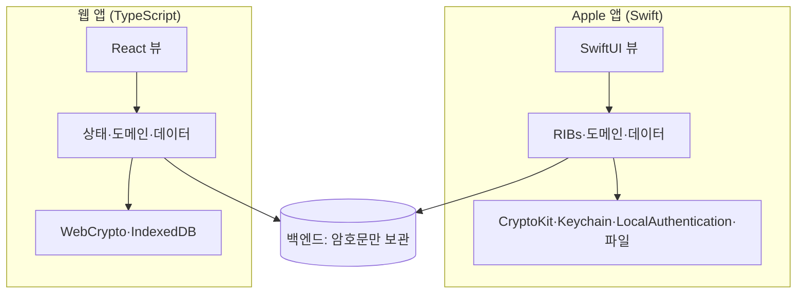
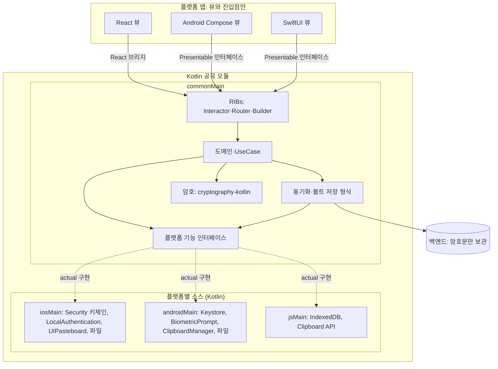

# KMP 전환 목표 구조

- 상태: 조사 문서(실험 브랜치 `research/kmp-migration` 전용, main에 합치지 않는다)
- 날짜: 2026-11-12
- 관련: [crypto-options.md](crypto-options.md)

> **요약** 앱(Swift·TypeScript·Android)에는 뷰와 진입점만 남긴다. 암호, 키체인·Keystore, 생체 인증, 클립보드, 기기 저장소 같은 플랫폼 기능도 앱이 구현해 주입하지 않고, 공유 모듈의 플랫폼별 소스(`iosMain`·`androidMain`·`jsMain`)에서 Kotlin으로 구현한다.

---

## 1. 지금 구조

같은 규칙(암호 규격, 동기화, 볼트 형식)을 플랫폼마다 따로 구현한다.

## 2. 목표 구조

- 플랫폼 기능 인터페이스는 공유 모듈 안에 있고, 구현도 공유 모듈 안의 Kotlin이다. 앱은 이 인터페이스를 구현하지 않는다.
- 앱 진입점이 넘기는 것은 화면 정보(생체 인증 창을 띄울 Activity·UIWindow 등)뿐이다.

## 3. 결정과 근거

| 항목 | 결정 | 근거 |
| :--- | :--- | :--- |
| 플랫폼 기능 위치 | 공유 모듈 플랫폼별 소스에서 Kotlin으로 구현 | 앱 주입 방식은 "뷰 외 전부 Kotlin" 목표와 맞지 않는다. |
| Kotlin으로 부를 수 있는가 | 가능 | Kotlin/Native는 C·Objective-C API(Security, LocalAuthentication, UIKit)를, Android는 JVM API를, Kotlin/JS는 브라우저 API를 직접 부른다. |
| Swift 전용 API | CryptoKit 하나뿐이며 라이브러리가 처리 | [crypto-options.md](crypto-options.md) 7장에서 iOS 시뮬레이터 벡터 테스트 통과. |
| 저장소 | 형식·동기화 로직은 공통, 저장 위치만 플랫폼별 | 오프라인 사용과 동기화 대기 때문에 기기 저장소가 필요하다(VLT-002, VLT-003). 저장 내용은 서버와 같은 암호문 형식이다. |
| 키체인·Keystore | 기기에 남김 | 생체 인증용 키는 기기 밖으로 나가면 안 된다. 영지식 원칙상 서버는 키를 갖지 않는다. |
| 웹 | 키체인·생체 인증 없음 | 브라우저에 대응 기능이 없으므로 웹은 해당 기능을 쓰지 않는다. |

## 4. 실험에서 확인할 것

| 항목 | 통과 기준 |
| :--- | :--- |
| iOS 키체인 | `iosMain` Kotlin 코드로 저장·조회·삭제가 실기기에서 동작 |
| iOS 생체 인증 | `LAContext` 평가와 키체인 접근 제어(생체 인증 필요 항목)가 실기기에서 동작 |
| Android | Keystore 키 생성과 `BiometricPrompt` 연동이 에뮬레이터·실기기에서 동작 |
| 웹 저장소 | IndexedDB에 볼트 암호문 저장·조회 |
| 앱 쪽 코드 | 앱에 플랫폼 기능 구현 코드가 남지 않음(진입점의 화면 정보 전달만 허용) |

## 5. 알려진 부담

1. Kotlin/Native에서 C API를 부르면 메모리를 직접 다뤄야 해서 같은 키체인 코드가 Swift보다 길다.
2. 키체인과 생체 인증은 시뮬레이터 제약이 있어 실기기 확인이 필요하다.
3. carti-RIBs-KMP에 브라우저 대상과 React 브리지가 아직 없다. 라이브러리 쪽에서 추가한다. 설계안은 [react-bridge.md](react-bridge.md).

## 6. 실험 결과: 키체인 (2026-11-12)

`Apps/Shared/secure-store` 모듈에 `SecureStore` 인터페이스(공통)와 `KeychainSecureStore`(`appleMain`)를 만들었다. Security 프레임워크의 `SecItemAdd`·`SecItemCopyMatching`·`SecItemDelete`를 Kotlin/Native에서 직접 부르고, Swift 코드는 없다. 접근 수준은 `kSecAttrAccessibleWhenUnlockedThisDeviceOnly`다.

| 대상 | 테스트 5건(저장·조회, 덮어쓰기, 삭제, 없는 항목 조회, 없는 항목 삭제) |
| :--- | :--- |
| macOS arm64 | 5/5 통과 |
| iOS 시뮬레이터 arm64 | 5/5 실패. 모든 호출이 `-25291`(`errSecNotAvailable`) |

- iOS 실패 원인: Kotlin/Native 테스트는 앱 번들 없이 실행 파일만 시뮬레이터에서 띄운다. 이 상태에서는 키체인 서비스를 쓸 수 없다. 같은 SecItem 호출이 macOS에서는 통과하므로 Kotlin 코드의 문제로 보지 않지만, iOS에서는 아직 확인하지 못했다.
- iOS 확인 방법: xcframework를 앱(또는 테스트 호스트 앱)에 넣어 그 안에서 실행한다. 4장의 "iOS 빌드" 항목과 함께 확인한다.
- 같은 키체인 코드는 Swift보다 길다(CoreFoundation 사전을 직접 만들고 해제). 5장 1번 부담이 실제로 나타났다.

### 6.1 iOS 호스트 앱 실행 결과 (2026-11-12)

Kotlin 테스트 실행 파일을 앱 번들(`Info.plist` 포함)로 감싸 시뮬레이터(iPhone 17 Pro, iOS 26.0)에 설치하고 실행했다.

| 시도 | 결과 |
| :--- | :--- |
| 앱 번들 + 임시 서명 | 5/5 실패. `-34018`(엔타이틀먼트 없음) |
| 엔타이틀먼트를 `codesign`에 넣음 | 앱 실행 자체가 거부됨(`SBMainWorkspace`) |
| 엔타이틀먼트를 링크 시 바이너리의 `__entitlements` 섹션에 넣음 | **5/5 통과** |

- 결론: `iosMain`의 Kotlin 키체인 코드는 iOS에서도 동작한다. 실패 원인은 실행 환경(앱 번들·엔타이틀먼트)이었고 코드는 고치지 않았다.
- 시뮬레이터는 Xcode 빌드처럼 엔타이틀먼트가 바이너리 섹션에 있어야 키체인을 연다. 실험용으로 `secure-store/build.gradle.kts`의 시뮬레이터 테스트 바이너리에 `-sectcreate` 링커 옵션을 넣었다.
- 실제 앱에서는 Xcode·Tuist가 앱 대상의 엔타이틀먼트를 넣으므로 Kotlin 프레임워크 쪽에 따로 할 일은 없다. 이건 4장 "iOS 빌드" 항목에서 확인한다.
- Gradle의 `iosSimulatorArm64Test`는 여전히 앱 번들 없이 실행하므로 실패한다. CI에서 iOS 키체인 테스트를 돌리려면 호스트 앱 실행 단계가 따로 필요하다.
- 아직 확인하지 못한 것: 실기기, 생체 인증 접근 제어(`SecAccessControl`).

## 7. 실험 결과: 생체 인증 (2026-11-12)

`secure-store` 모듈 `appleMain`에 Kotlin으로 추가했다. Swift 코드는 없다.

- `LocalBiometricAuthenticator`: LocalAuthentication의 `LAContext.canEvaluatePolicy`·`evaluatePolicy`를 직접 부른다. 콜백은 `suspendCancellableCoroutine`으로 `suspend` 함수가 되고, 코루틴이 취소되면 `LAContext.invalidate()`로 인증 창을 닫는다.
- `BiometricKeychainStore`: 키체인 항목에 `SecAccessControl`(`kSecAccessControlBiometryCurrentSet`, 현재 등록된 생체만 허용)을 건다. 읽을 때 `LAContext`로 먼저 인증하고 그 컨텍스트를 `kSecUseAuthenticationContext`로 넘겨 인증 창이 두 번 뜨지 않게 한다.
- 공통 인터페이스는 `BiometricAuthenticator`, `BiometricSecureStore`이고, 결과는 `Success`·`Cancelled`·`Failed(code, message)`로 나눈다.

시뮬레이터(iPhone 17 Pro, iOS 26.0)에서 6.1장의 호스트 앱 방식으로 실행했다. Face ID 등록과 얼굴 일치·불일치는 `notifyutil` 신호(`com.apple.BiometricKit.enrollmentChanged`, `com.apple.BiometricKit_Sim.pearl.match`·`nomatch`)로 보냈다. `Info.plist`에 `NSFaceIDUsageDescription`이 필요하다.

| 시나리오 | 결과 |
| :--- | :--- |
| Face ID 등록 → 보호 저장 → 일치 신호 → 보호 조회 | 통과. 저장한 32바이트를 그대로 읽음 |
| 불일치 신호 | 시스템이 "얼굴이 인식되지 않음" 창을 띄우고 기다림. 키를 내주지 않음 |
| 불일치 후 취소 | `Cancelled`로 `BiometricAuthenticationException`. 키를 내주지 않음 |
| 기존 키체인 테스트 5건 | 같은 실행에서 모두 통과 |

- 결론: 생체 인증과 생체 보호 키체인도 `iosMain` Kotlin 코드만으로 동작한다. 앱이 넘길 것은 없었다. iOS 인증 창은 시스템이 띄우므로 화면 정보가 필요 없다(Android `BiometricPrompt`는 Activity가 필요하다).
- 실험 설정: 시뮬레이터에 암호가 없어서 접근 수준을 `kSecAttrAccessibleWhenUnlockedThisDeviceOnly`로 했다. 이후 `WhenPasscodeSetThisDeviceOnly`로 정했다(11장).
- 생체 인증 테스트는 Face ID 신호가 필요해서 `iosSimulatorArm64Test`에만 두었다. Gradle 테스트 작업으로는 돌지 않고 호스트 앱 실행으로만 확인된다. macOS 테스트에는 넣지 않았다(개발 기기에서 Touch ID 창이 뜬다).
- 아직 확인하지 못한 것: 실기기, 생체 등록 변경 후 항목 무효화, Android `BiometricPrompt`.

## 8. Android 구현 (2026-11-12, 기기 검증 전)

Android 테스트는 Windows 환경에서 하기로 해서, 여기서는 코드와 설정까지만 만들었다.

- 설정: AGP 9.5.1의 `com.android.kotlin.multiplatform.library`(carti-RIBs-KMP와 같음), `compileSdk 37`, `minSdk 26`. SDK 경로는 `Apps/Shared/local.properties`(git 제외)에 둔다.
- `crypto`: Android 대상과 `Nfc.android.kt`(`java.text.Normalizer`)를 추가했다. 공통 테스트(테스트 벡터)를 기기 계측 테스트로 돈다(`withDeviceTestBuilder { sourceSetTreeName = "test" }`).
- `secure-store` `androidMain`:
  - `KeystoreSecureStore`: Android Keystore의 AES-256-GCM 키로 값을 감싸고, IV + 암호문만 앱 전용 SharedPreferences에 둔다.
  - `AndroidBiometricAuthenticator`: `BiometricPrompt`(`BIOMETRIC_STRONG`). 인증 창을 띄울 `FragmentActivity`를 생성자로 받는다. 앱 진입점이 넘기는 유일한 화면 정보다.
  - `BiometricKeystoreStore`: 매 사용마다 생체 인증이 필요하고 생체 등록이 바뀌면 무효가 되는 Keystore 키로 값을 감싼다. 인증된 `CryptoObject`의 `Cipher`로만 암·복호화한다.
- 공통 인터페이스 변경: 인증 필요 Keystore 키는 암호화할 때도 인증을 요구한다. 그래서 `BiometricSecureStore.saveProtected`를 `suspend`로 바꿨고 Apple 구현도 맞췄다.

| 확인 항목 | 상태 |
| :--- | :--- |
| `crypto`·`secure-store` `androidMain` 컴파일 | 통과(macOS에서 Gradle 실행 중 확인) |
| `crypto` 기기 테스트 컴파일 | 통과 |
| `secure-store` 기기 테스트 컴파일 | 통과(8.1) |
| 에뮬레이터·기기 실행(테스트 벡터, Keystore 5건, 생체 인증 1건) | 에뮬레이터 통과(8.1), 실기기 확인 안 함 |
| 인터페이스 변경 후 Apple | macOS 테스트 통과, iOS 시뮬레이터 테스트 바이너리 링크 성공. 호스트 앱 재실행은 안 함 |

Windows에서 실행하는 방법:

- 테스트 벡터: `gradlew :crypto:connectedAndroidDeviceTest`
- Keystore만: `gradlew :secure-store:connectedAndroidDeviceTest -Pandroid.testInstrumentationRunnerArguments.class=com.keymanage.securestore.KeystoreSecureStoreTest`
- 생체 인증: 기기에 화면 잠금과 지문을 먼저 등록한다. 테스트 중 logcat에 `KM_BIOMETRIC_PROMPT`가 찍힐 때마다(저장 1회, 조회 1회) `adb emu finger touch 1`을 보낸다.
- Apple 대상은 Windows에서 빌드되지 않고 `kotlin.native.ignoreDisabledTargets=true`로 건너뛴다.

### 8.1 Windows 에뮬레이터 실행 결과 (2026-11-12)

에뮬레이터(Medium Phone, API 37, x86_64, Google Play 이미지)에서 실행했다. 화면 잠금은 `adb shell locksettings set-pin`으로 설정하고, 지문은 설정 앱 등록 화면에서 `adb emu finger touch 1`로 등록했다.

| 확인 항목 | 결과 |
| :--- | :--- |
| `crypto` 테스트 벡터 | 7/7 통과 |
| `secure-store` Keystore | 5/5 통과 |
| `secure-store` 생체 보호 Keystore(저장·조회 각 1회 지문 일치) | 1/1 통과 |

Windows에서 처음 빌드할 때 `crypto/build.gradle.kts`의 테스트 벡터 생성 작업을 두 군데 고쳤다. 제품 코드는 고치지 않았다.

- 생성 작업이 `compileTestKotlin*`에만 걸려 있어서 Android 기기 테스트 컴파일(`compileAndroidDeviceTest`)이 상수를 찾지 못했다. 이 작업에도 의존성을 걸었다.
- Windows에서 체크아웃한 JSON은 줄 끝이 CRLF라 `\r`이 Kotlin 문자열 안에 그대로 들어가 문법 오류가 났다. `\r`을 지운 뒤 변환한다.

`local.properties`의 `sdk.dir`은 역슬래시 대신 `/`로 쓴다. `\U`가 유니코드 이스케이프로 읽혀 Gradle 설정 단계가 실패한다.

아직 확인하지 못한 것: 실기기, 생체 등록 변경 후 키 무효화, 지문 불일치·취소 경로.

## 9. 실험 결과: 웹 저장소 (2026-11-12)

`Apps/Shared/device-store` 모듈을 새로 만들었다. 공통 인터페이스는 `DeviceStore`(`load`·`save`·`clear`, 모두 `suspend`)이고, 웹 구현은 `jsMain`의 `IndexedDbDeviceStore`다. TypeScript 코드는 없다.

- 기록 형식은 공통 코드가 정한다. 인터페이스는 기록을 JSON 문자열로 주고받고, 플랫폼 구현은 형식을 해석하지 않는다(3장 "저장소" 결정).
- 지금 웹 앱(`Apps/Web/src/adapters/browser/indexedDbDeviceStore.ts`)과 같은 DB(`keymanage` v1), 저장소(`device`), 키(`account`)를 쓴다. 기록도 문자열이 아닌 객체로 저장한다. 그래서 저장 데이터 형식은 바뀌지 않고, 기존 사용자의 기록을 옮기지 않아도 된다.
- 동작도 TypeScript 구현과 맞췄다: 열기 제한 시간 3초, 다른 탭의 차단은 실패로 처리, `onversionchange` 때 연결 닫기, 쓰기는 트랜잭션이 끝나야 성공.

| 대상 | 테스트 6건 |
| :--- | :--- |
| Chrome Headless 156 (Windows, Karma) | 6/6 통과 |

- 6건: 빈 상태 조회, 저장 후 조회, 덮어쓰기, 삭제, 기존 웹 앱이 쓴 기록 읽기, Kotlin이 쓴 기록이 객체로 저장되는지.
- 테스트가 실제로 형식을 잡는지 확인하려고 구현을 일부러 문자열 저장으로 바꿔 돌렸다. 3건이 실패했고 원래대로 되돌렸다.
- 실행: `CHROME_BIN`에 Chrome 경로를 넣고 `gradlew :device-store:jsBrowserTest`.
- 아직 확인하지 못한 것: Firefox·Safari, 열기 시간 초과·차단 경로 테스트, 저장 공간 부족, `navigator.storage.persist` 요청(지금 웹 앱에는 있다), Android·Apple 구현.

## 10. 실험 결과: 웹 암호 호환 (2026-11-12)

`crypto` 모듈의 JS 대상(cryptography-kotlin, 내부적으로 WebCrypto)이 지금 웹 앱 TypeScript 구현과 같은 결과를 내는지 확인했다. 코드는 고치지 않았다.

- 기준은 `docs/crypto-test-vectors.json`이다. 웹 앱 TypeScript 테스트(`Apps/Web/src/domain/crypto/testVectors.ts`를 쓰는 8개 파일)도 같은 파일을 읽는다.
- Kotlin 테스트는 비밀번호 전처리(NFC·공백 정리), PBKDF2 마스터 키, HKDF 암호화 키·인증 해시를 바이트 단위로 비교한다. AES-GCM은 벡터의 고정 IV로 암호화해 암호문과 태그를 바이트 단위로 비교하고, 다시 복호화한다.

| 대상 | 결과 |
| :--- | :--- |
| Kotlin/JS 브라우저(Chrome Headless 156) | 7/7 통과 |
| Kotlin/JS Node | 7/7 통과 |
| Kotlin/JVM | 7/7 통과 |
| 웹 앱 TypeScript(같은 벡터를 쓰는 테스트 파일 8개) | 141/141 통과 |

- 결론: 두 구현이 같은 벡터를 바이트 단위로 통과하므로 키 유도와 볼트 암호문 형식이 같다. 웹을 Kotlin 암호로 바꿔도 기존 볼트를 그대로 열 수 있다. 저장 데이터 형식 결정은 생기지 않았다.
- AES-GCM은 키·IV·AAD가 같으면 결과가 하나로 정해지므로, 무작위 IV 교차 검증(Kotlin이 암호화하고 TypeScript가 복호화)은 따로 하지 않았다.
- 아직 확인하지 못한 것: Firefox·Safari의 WebCrypto, 5MB 볼트(VLT-001)에서 속도 비교, 백업 파일 형식(`backupFile`)의 Kotlin 구현.

## 11. 결정: 생체 해제용 키의 키체인 접근 수준 (2026-11-12)

iOS 생체 보호 키체인 항목(`BiometricKeychainStore`)의 접근 수준을 `kSecAttrAccessibleWhenPasscodeSetThisDeviceOnly`로 정했다. 보안 경계 결정이라 사용자가 정했다.

| 선택지 | 기기 암호를 끄면 | 판단 |
| :--- | :--- | :--- |
| `WhenPasscodeSetThisDeviceOnly` | iOS가 항목을 지운다 | **채택** |
| `WhenUnlockedThisDeviceOnly`(실험 때 값) | 항목은 남지만 Face ID도 꺼져 생체 보호 항목은 읽을 수 없다 | 채택 안 함 |

- 근거: Android Keystore의 인증 필요 키(`setUserAuthenticationRequired`)는 화면 잠금을 끄면 영구히 무효가 된다. 두 플랫폼이 같은 동작을 하고, 쓸 수 없는 키가 기기에 남지 않는다.
- 사용자 영향: 기기 암호를 껐다 다시 켜면 생체 해제가 풀려 있다. 마스터 비밀번호로 잠금을 풀고 생체 인증을 다시 켜야 한다. SEC-003 8번(생체 정보 변경 시 생체 해제 무효화)과 같은 흐름이다.
- 범위: 생체 보호 항목만 바꿨다. 일반 `KeychainSecureStore`(세션 토큰 등)는 `WhenUnlockedThisDeviceOnly` 그대로다.
- 확인하지 못한 것: Windows에서는 Apple 대상을 빌드할 수 없어 컴파일·실행을 확인하지 않았다. 시뮬레이터에는 기기 암호가 없어 `WhenPasscodeSet` 항목 저장이 실패할 수 있다(`errSecNotAvailable` 예상). 7장의 생체 인증 시뮬레이터 테스트는 Mac에서 다시 돌려 확인해야 하고, 실패하면 실기기에서 확인한다.
- 정책 반영: `docs/policies/SEC/SEC-003`에는 기기 암호를 끌 때의 동작이 없다. 정책은 main의 SSOT이므로 이 실험 브랜치가 아니라 main에서 따로 고친다.
