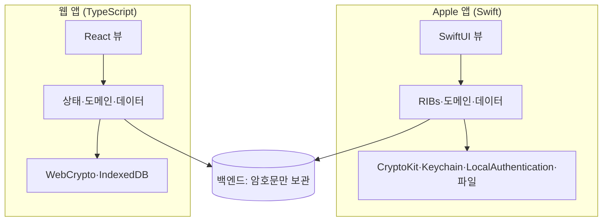
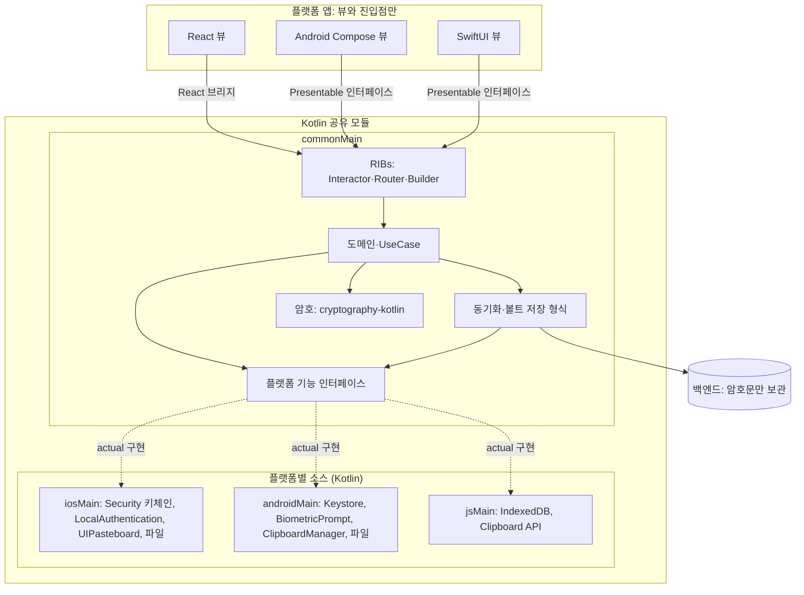

# KMP 전환 목표 구조

- 상태: 조사 문서(실험 브랜치 `research/kmp-migration` 전용, main에 합치지 않는다)
- 날짜: 2026-11-12
- 관련: [crypto-options.md](crypto-options.md)

> **요약** 앱(Swift·TypeScript·Android)에는 뷰와 진입점만 남긴다. 암호, 키체인·Keystore, 생체 인증, 클립보드, 기기 저장소 같은 플랫폼 기능도 앱이 구현해 주입하지 않고, 공유 모듈의 플랫폼별 소스(`iosMain`·`androidMain`·`jsMain`)에서 Kotlin으로 구현한다.

---

## 1. 지금 구조

같은 규칙(암호 규격, 동기화, 볼트 형식)을 플랫폼마다 따로 구현한다.

## 2. 목표 구조

- 플랫폼 기능 인터페이스는 공유 모듈 안에 있고, 구현도 공유 모듈 안의 Kotlin이다. 앱은 이 인터페이스를 구현하지 않는다.
- 앱 진입점이 넘기는 것은 화면 정보(생체 인증 창을 띄울 Activity·UIWindow 등)뿐이다.

## 3. 결정과 근거

| 항목 | 결정 | 근거 |
| :--- | :--- | :--- |
| 플랫폼 기능 위치 | 공유 모듈 플랫폼별 소스에서 Kotlin으로 구현 | 앱 주입 방식은 "뷰 외 전부 Kotlin" 목표와 맞지 않는다. |
| Kotlin으로 부를 수 있는가 | 가능 | Kotlin/Native는 C·Objective-C API(Security, LocalAuthentication, UIKit)를, Android는 JVM API를, Kotlin/JS는 브라우저 API를 직접 부른다. |
| Swift 전용 API | CryptoKit 하나뿐이며 라이브러리가 처리 | [crypto-options.md](crypto-options.md) 7장에서 iOS 시뮬레이터 벡터 테스트 통과. |
| 저장소 | 형식·동기화 로직은 공통, 저장 위치만 플랫폼별 | 오프라인 사용과 동기화 대기 때문에 기기 저장소가 필요하다(VLT-002, VLT-003). 저장 내용은 서버와 같은 암호문 형식이다. |
| 키체인·Keystore | 기기에 남김 | 생체 인증용 키는 기기 밖으로 나가면 안 된다. 영지식 원칙상 서버는 키를 갖지 않는다. |
| 웹 | 키체인·생체 인증 없음 | 브라우저에 대응 기능이 없으므로 웹은 해당 기능을 쓰지 않는다. |

## 4. 실험에서 확인할 것

| 항목 | 통과 기준 |
| :--- | :--- |
| iOS 키체인 | `iosMain` Kotlin 코드로 저장·조회·삭제가 실기기에서 동작 |
| iOS 생체 인증 | `LAContext` 평가와 키체인 접근 제어(생체 인증 필요 항목)가 실기기에서 동작 |
| Android | Keystore 키 생성과 `BiometricPrompt` 연동이 에뮬레이터·실기기에서 동작 |
| 웹 저장소 | IndexedDB에 볼트 암호문 저장·조회 |
| 앱 쪽 코드 | 앱에 플랫폼 기능 구현 코드가 남지 않음(진입점의 화면 정보 전달만 허용) |

## 5. 알려진 부담

1. Kotlin/Native에서 C API를 부르면 메모리를 직접 다뤄야 해서 같은 키체인 코드가 Swift보다 길다.
2. 키체인과 생체 인증은 시뮬레이터 제약이 있어 실기기 확인이 필요하다.
3. carti-RIBs-KMP에 브라우저 대상과 React 브리지가 아직 없다. 라이브러리 쪽에서 추가한다.

## 6. 실험 결과: 키체인 (2026-11-12)

`Apps/Shared/secure-store` 모듈에 `SecureStore` 인터페이스(공통)와 `KeychainSecureStore`(`appleMain`)를 만들었다. Security 프레임워크의 `SecItemAdd`·`SecItemCopyMatching`·`SecItemDelete`를 Kotlin/Native에서 직접 부르고, Swift 코드는 없다. 접근 수준은 `kSecAttrAccessibleWhenUnlockedThisDeviceOnly`다.

| 대상 | 테스트 5건(저장·조회, 덮어쓰기, 삭제, 없는 항목 조회, 없는 항목 삭제) |
| :--- | :--- |
| macOS arm64 | 5/5 통과 |
| iOS 시뮬레이터 arm64 | 5/5 실패. 모든 호출이 `-25291`(`errSecNotAvailable`) |

- iOS 실패 원인: Kotlin/Native 테스트는 앱 번들 없이 실행 파일만 시뮬레이터에서 띄운다. 이 상태에서는 키체인 서비스를 쓸 수 없다. 같은 SecItem 호출이 macOS에서는 통과하므로 Kotlin 코드의 문제로 보지 않지만, iOS에서는 아직 확인하지 못했다.
- iOS 확인 방법: xcframework를 앱(또는 테스트 호스트 앱)에 넣어 그 안에서 실행한다. 4장의 "iOS 빌드" 항목과 함께 확인한다.
- 같은 키체인 코드는 Swift보다 길다(CoreFoundation 사전을 직접 만들고 해제). 5장 1번 부담이 실제로 나타났다.

### 6.1 iOS 호스트 앱 실행 결과 (2026-11-12)

Kotlin 테스트 실행 파일을 앱 번들(`Info.plist` 포함)로 감싸 시뮬레이터(iPhone 17 Pro, iOS 26.0)에 설치하고 실행했다.

| 시도 | 결과 |
| :--- | :--- |
| 앱 번들 + 임시 서명 | 5/5 실패. `-34018`(엔타이틀먼트 없음) |
| 엔타이틀먼트를 `codesign`에 넣음 | 앱 실행 자체가 거부됨(`SBMainWorkspace`) |
| 엔타이틀먼트를 링크 시 바이너리의 `__entitlements` 섹션에 넣음 | **5/5 통과** |

- 결론: `iosMain`의 Kotlin 키체인 코드는 iOS에서도 동작한다. 실패 원인은 실행 환경(앱 번들·엔타이틀먼트)이었고 코드는 고치지 않았다.
- 시뮬레이터는 Xcode 빌드처럼 엔타이틀먼트가 바이너리 섹션에 있어야 키체인을 연다. 실험용으로 `secure-store/build.gradle.kts`의 시뮬레이터 테스트 바이너리에 `-sectcreate` 링커 옵션을 넣었다.
- 실제 앱에서는 Xcode·Tuist가 앱 대상의 엔타이틀먼트를 넣으므로 Kotlin 프레임워크 쪽에 따로 할 일은 없다. 이건 4장 "iOS 빌드" 항목에서 확인한다.
- Gradle의 `iosSimulatorArm64Test`는 여전히 앱 번들 없이 실행하므로 실패한다. CI에서 iOS 키체인 테스트를 돌리려면 호스트 앱 실행 단계가 따로 필요하다.
- 아직 확인하지 못한 것: 실기기, 생체 인증 접근 제어(`SecAccessControl`).
